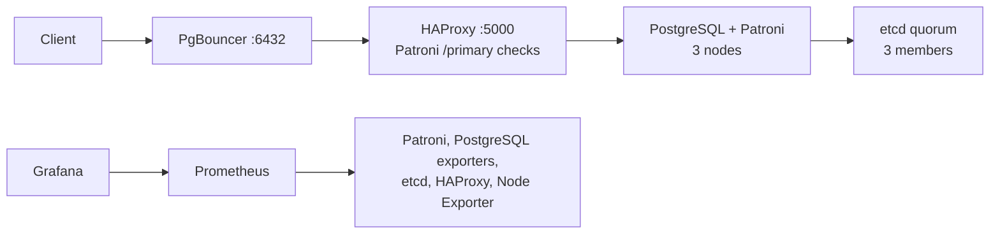

# PostgreSQL High-Availability Failover Lab

A local infrastructure lab for exploring PostgreSQL 16 high availability with Patroni, etcd, HAProxy, PgBouncer, Prometheus, and Grafana.

> **Scope:** This Compose deployment runs on a single host. It is designed for controlled process/container-failure experiments and learning—not production-grade host-level high availability.

## Project Overview

The lab brings together a three-node PostgreSQL cluster, Patroni-based leader management, etcd coordination, role-aware connection routing, connection pooling, and a basic observability stack.

### Architecture



## Implemented Capabilities

The current repository includes:

- A Docker Compose topology for three PostgreSQL 16 instances managed by Patroni.
- Three etcd members for leader coordination and quorum.
- HAProxy routing based on Patroni's `/primary` health endpoint.
- PgBouncer transaction pooling for application connections.
- Environment-based secrets and startup-time volume ownership correction.
- Prometheus scraping for Patroni, PostgreSQL, etcd, HAProxy, and Node Exporter.
- A provisioned Grafana overview dashboard and baseline alert rules.
- A guarded primary-container-stop failover experiment.
- A concurrent workload generator and a client-side acknowledged-write ledger.

The failover runner records experiment output under `experiments/results/` (ignored by Git). It uses monotonic timing and UUIDs in a locally fsynced commit ledger. A small commit-acknowledgement-to-ledger-write interval remains a measurement limitation.

## Current Scope and Next Phases

The repository establishes the local cluster and its supporting routing, pooling, and monitoring components. The following work is planned for subsequent validation and development phases:

| Area | Current position |
|---|---|
| Local cluster topology | Implemented in Docker Compose |
| Patroni leader management and HAProxy role-aware routing | Implemented |
| PgBouncer transaction pooling | Implemented |
| Baseline metrics, dashboard, and alerts | Implemented |
| Guarded primary-stop experiment runner | Implemented; execution results are not included |
| Backup automation and WAL archiving | Planned |
| Point-in-time recovery (PITR) and restore verification | Planned |
| Broader chaos and network-partition scenarios | Planned |
| Runtime integration validation | Further validation required |
| Multi-host deployment and failure-domain separation | Planned |

**Measurement note:** No RTO/RPO measurements are reported in this repository. Run the experiment framework and retain its generated output before publishing measured results. Keep design goals separate from observed measurements.

## Requirements

- Docker Engine with Docker Compose v2
- Python 3.11 or later
- PostgreSQL client tools (`psql`) for direct SQL access
- At least 8 GB RAM (12 GB or more recommended)

## Quick Start

1. Copy `.env.example` to `.env`.
2. Replace every placeholder with a distinct, shell-safe secret. For example, generate values with `openssl rand -hex 32`.
3. Create a virtual environment, install the project dependencies, and start the stack:

```sh
python3 -m venv .venv
.venv/bin/pip install -e '.[test]'
docker compose up -d --build
./scripts/wait-for-primary.sh
./scripts/cluster-status.sh
./scripts/init-app.sh
```

## Connection Endpoints

| Component | Local endpoint |
|---|---|
| PgBouncer | `127.0.0.1:6432` |
| HAProxy write endpoint | `127.0.0.1:5000` |
| Grafana | `http://127.0.0.1:3000` |
| Prometheus | `http://127.0.0.1:9090` |
| HAProxy stats | `http://127.0.0.1:8404/` |

Database and Patroni diagnostic ports are also published on localhost only.

## Replication and Failover Design

Three Patroni-managed PostgreSQL instances use etcd for leader coordination and streaming replication. HAProxy checks Patroni's `/primary` endpoint when selecting the write target; a replica accepting TCP connections is not sufficient for write routing.

Asynchronous replication is the default. To enable Patroni-managed synchronous mode with one standby on a fresh cluster, set:

```env
POSTGRES_SYNC_MODE=true
```

The configured non-strict policy allows writes to continue when a synchronous standby is unavailable. It should therefore not be treated as a strict durability guarantee. For an existing cluster, review Patroni's DCS and dynamic configuration before changing replication policy; changing the Compose environment alone may not update stored configuration.

One primary-stop failure experiment is provided:

```sh
make failover
```

The command requests explicit lab confirmation and records a run. For five repetitions:

```sh
make benchmark
```

This command also requests confirmation. Review the generated files in `experiments/results/` after execution.

### Concurrent Workload

Export `APP_PASSWORD` in the shell, then run the workload generator:

```sh
python3 -m application.workload \
  --clients 8 \
  --transactions-per-second 20 \
  --write-ratio 0.8 \
  --duration 120
```

The JSON summary and acknowledged-write ledger are written to `experiments/results/` by default. The workload can run in a separate terminal during an explicitly approved failover experiment.

## Observability

Prometheus is configured to scrape:

- Patroni
- One `postgres_exporter` per database node
- etcd metrics
- HAProxy metrics
- Node Exporter

Grafana provisions an overview dashboard. Baseline alert rules cover target availability, etcd leader presence, replication lag, connections, and disk usage. These are initial operational baselines, not tuned service-level objective (SLO) alerts.

Node Exporter mounts host `/proc`, `/sys`, and filesystem paths read-only. Review the host-access implications before running this Compose configuration on a shared machine.

## Recovery and Measurement Status

Backup and recovery workflows are not yet part of the implemented stack. In particular, WAL archiving, base backups, retention, backup verification, and PITR restore procedures remain planned work. Persistent Docker volumes are not backups.

The experiment framework provides a basis for collecting failover observations, but no experimental result is included here. RTO should be reported from actual run output. RPO should be assessed using acknowledged commits—not merely attempted writes—and compared against the recovered database.

## Data Lifecycle and Safety

- `docker compose down` and `make clean` preserve named volumes.
- `make clean-volumes` is destructive and requires `CONFIRM_DATA_DELETION=postgres-ha-lab`.
- Do not run destructive volume operations against data that matters.
- Do not simulate loss of two etcd members in an environment containing data that matters.
- Treat this as an isolated lab, not a shared or production database service.

## Documentation

- [System architecture](docs/architecture/system-overview.md)
- [Database topology](docs/architecture/database-topology.md)
- [Network topology](docs/architecture/network-topology.md)
- [Component notes](docs/components/README.md)
- [Endpoints](docs/endpoints/README.md)
- [Application flow](docs/application-flow/README.md)
- [Operations runbook](docs/operations/runbooks.md)
- [Failure scenarios and status](docs/failure-scenarios/README.md)
- [PITR status](docs/recovery/pitr.md)
- [Disaster recovery](docs/recovery/disaster-recovery.md)
- [Architecture decisions](docs/decisions/README.md)

## Production Readiness Considerations

This single-host lab does not provide host-level high availability. The current deployment also uses plaintext internal connections, lacks authenticated/TLS-protected etcd, has no external secret manager or remote backup target, and has no restore-tested disaster-recovery path.

A production-oriented deployment would require independent failure domains, fencing, private TLS networking, external backups, tested restoration, resource sizing, and maintenance and upgrade automation.
