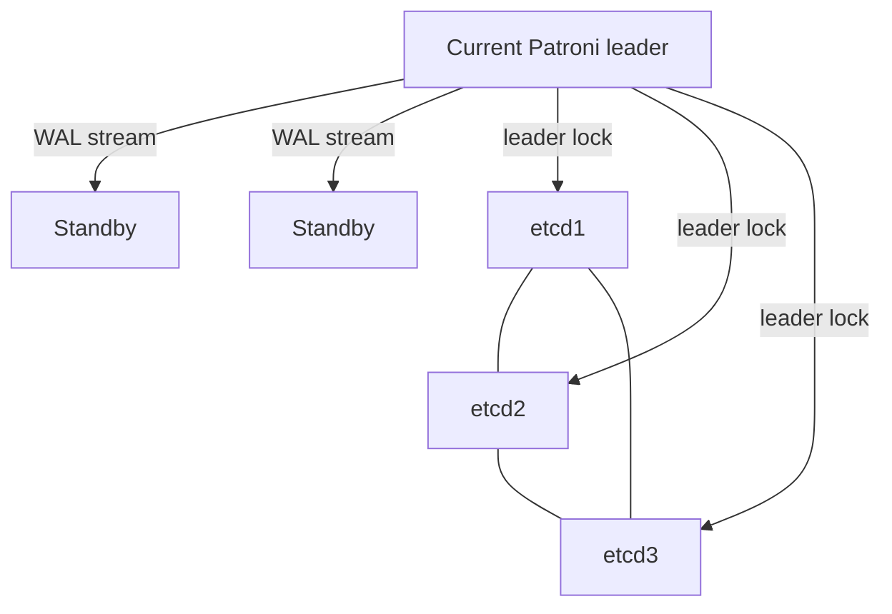

# Database topology

Each PostgreSQL 16 container runs Patroni. The first node able to initialize an empty cluster bootstraps the shared DCS; the remaining nodes clone from the current leader. All nodes use the same cluster scope and connect to the three etcd client endpoints. PostgreSQL listens inside the Compose network, and each data directory is backed by its own named volume.

The startup renderer sets asynchronous replication by default and enables Patroni synchronous mode at bootstrap when `POSTGRES_SYNC_MODE=true`. The bootstrap DCS sets one synchronous standby and non-strict synchronous mode; writes can continue without a standby, so the mode is not a hard durability guarantee. Synchronous commit acknowledgment depends on Patroni selecting a synchronous standby and PostgreSQL's `synchronous_commit`; synchronous mode does not guarantee zero RPO for every failure. Verify `pg_stat_replication.sync_state` and Patroni state before drawing conclusions. Changing these bootstrap variables does not rewrite an initialized cluster's dynamic DCS configuration.

If the leader fails while etcd retains quorum, Patroni can promote an eligible replica. A former leader must rejoin as a standby; `use_pg_rewind` is configured, but actual rejoin behavior has not yet been verified in an integration run. Loss of two etcd members removes quorum; no new leader should be elected until a majority returns.

WAL archiving and PITR are not configured in this implementation. Streaming replication alone is not a backup.
