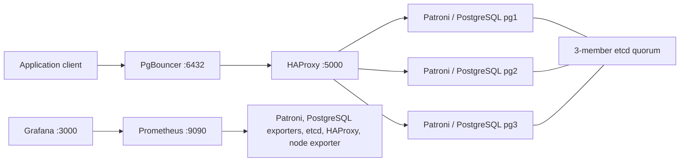

# System overview

## Goals

This Compose profile is a local failure laboratory for PostgreSQL 16, Patroni leader management, etcd quorum behavior, write routing, connection pooling, and measurable client recovery. It is not host-level HA or a production deployment.

## Components and boundaries

All nodes share one Docker host and one bridge network. Published endpoints bind to loopback. Database and Patroni REST ports remain available on localhost for diagnostics. etcd has no published host port. Trust inside the Docker network is not encrypted; do not attach untrusted containers or expose this network externally.

## HA and DR model

Patroni uses a three-member etcd cluster for leader coordination. A majority of two members is needed to make progress. PostgreSQL uses physical streaming replication and Patroni-managed slots/rewind settings. HAProxy checks Patroni `/primary` before routing TCP writes. PgBouncer fronts this route in transaction pooling mode.

The local persistent volumes survive container recreation. They are not deleted by `make clean`. `make clean-volumes` requires an explicit environment confirmation and is destructive. No backup/PITR subsystem is currently installed; Compose volume persistence is not a backup.

## Profiles and production boundary

The implemented profile is local Compose only. A multi-host reference needs three database hosts and three etcd members distributed across independent failure domains, private network ACLs, TLS, external secrets, independent storage and backup targets, and tested restore automation. No multi-host provisioning template is currently supplied.

## Decisions

Patroni and etcd provide a well-understood leader-lock model. HAProxy uses REST role checks because a TCP accept check cannot establish that a node is writable primary. PgBouncer uses transaction pooling to limit backend connections; applications must not depend on session-scoped state. Details and gaps are tracked under `docs/decisions/`.
